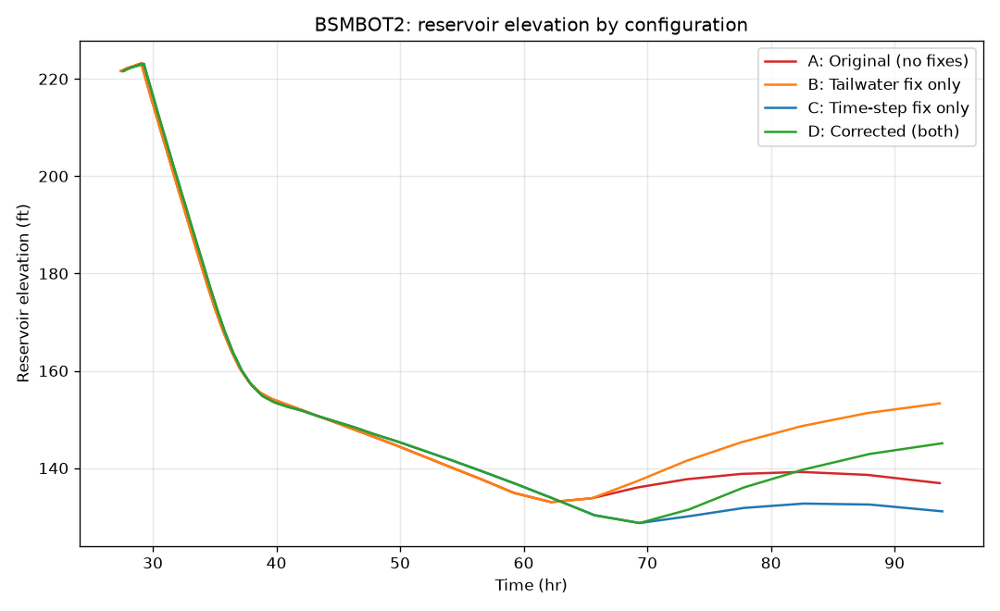
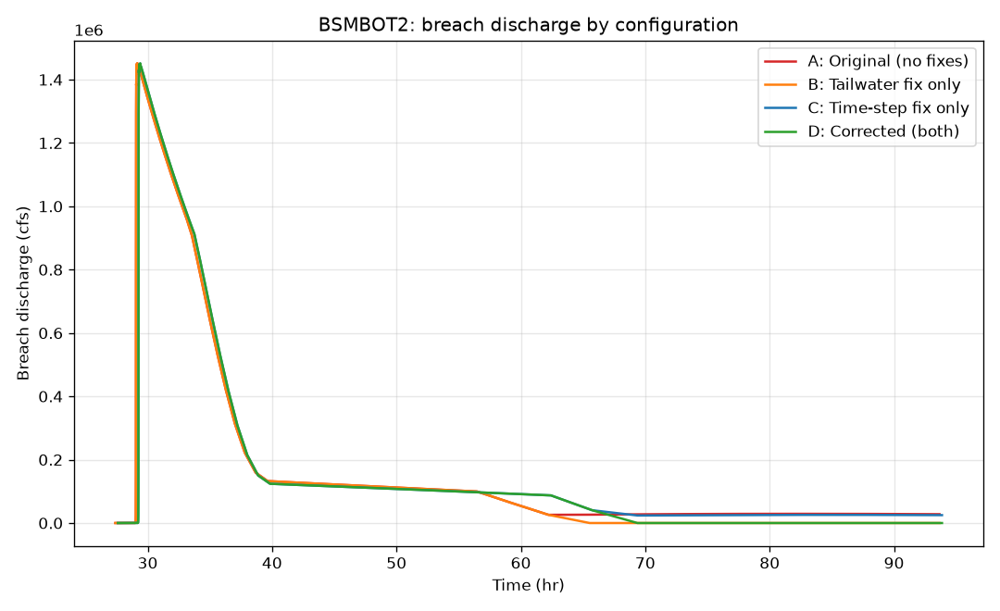
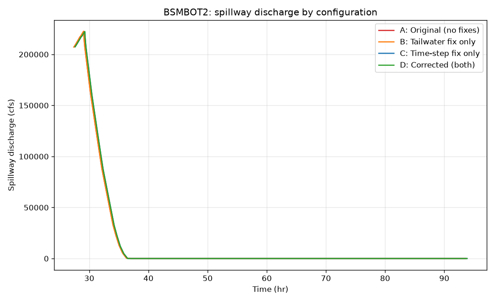
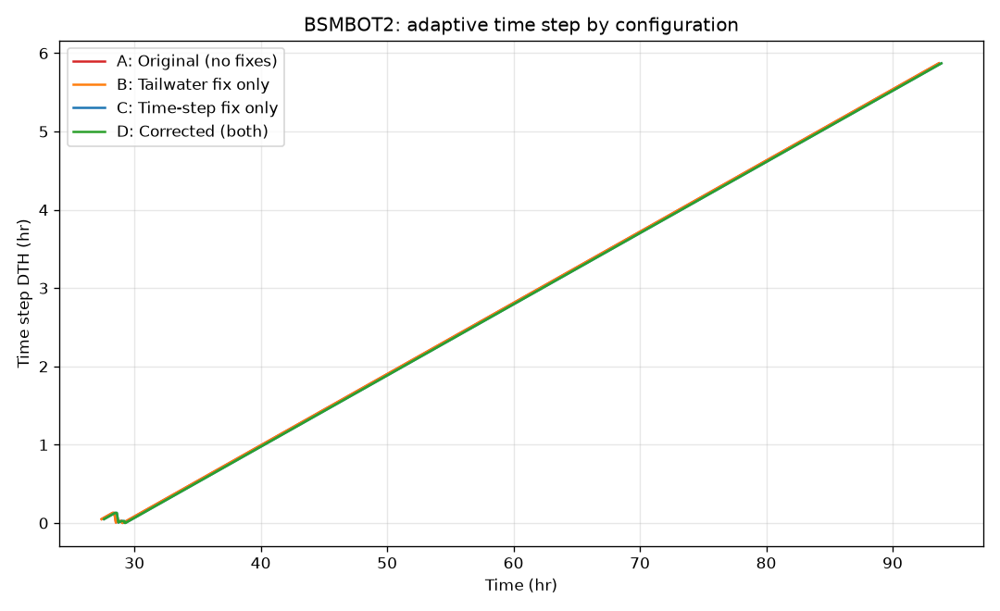

# BSMBOT2_FIX_ATTRIBUTION.md

## Method

Four source variants were generated by `tools/build_attribution_variants.py`, which applies the BRCH2010-01/02 ("tailwater fix") and/or BRCH2018-05 ("time-step fix") patches in isolation to a fresh copy of `original/SRC/Breach.for` (never to `original/` itself, and never touching the operational `src/breach1999_documented_corrections.f`, to keep that file's readability intact per this task's instructions). "Tailwater fix" bundles BRCH2010-01 (`TWD≥HY ⇒ QB=0`, applied at both the piping-orifice `HEAD` calc and the weir-path `SUB` calc) with BRCH2010-02 (`TWD` initialized to `HSTW(1)`) since the two are not meaningfully separable (BRCH2010-01's guard reads `TWD`, whose starting value BRCH2010-02 changes). "Time-step fix" is BRCH2018-05 in full (`DTH≥0.0001` floor, `DTHFIL≤0.5` ceiling, steady-state override).

| Configuration | Tailwater fix | Time-step fix | Source |
|---|:---:|:---:|---|
| A: Original | OFF | OFF | `tests/attribution/variants/breach_A_original.f` |
| B: Tailwater only | ON | OFF | `tests/attribution/variants/breach_B_tailwater_only.f` |
| C: Time-step only | OFF | ON | `tests/attribution/variants/breach_C_timestep_only.f` |
| D: Corrected (both) | ON | ON | `tests/attribution/variants/breach_D_both.f` |

All 4 compile cleanly (`gfortran -std=legacy -ffixed-form -O0 -fno-range-check`, zero warnings) and run to completion (exit 0) on `examples/BSMBOT2.DAT`. **Configuration D's output is bit-for-bit identical to the actual `src/breach1999_documented_corrections.f` build's BSMBOT2 output**, confirming this isolation setup is valid — none of this project's other corrections (NHSA, NCS, negative-BMX fallback, AFRA, reservoir-refill guard, cosmetic formatting) change BSMBOT2's result at all (previously confirmed in the regression logs from each of those commits).

## Results table

| Metric | A: Original | B: Tailwater only | C: Time-step only | D: Both (=corrected) |
|---|---:|---:|---:|---:|
| QBP (peak breach discharge, cfs) | 1,450,576 | 1,450,576 | 1,451,339 | 1,451,339 |
| QP (peak total discharge, cfs) | 1,664,275 | 1,664,275 | 1,662,832 | 1,662,832 |
| TP (time to peak, hr) | 29.14 | 29.14 | 29.32 | 29.32 |
| TRS (rising-limb duration, hr) | 0.16 | 0.16 | 0.14 | 0.14 |
| TB (rise-onset time, hr) | 28.98 | 28.98 | 29.18 | 29.18 |
| BRD (final breach depth, ft) | 209.32 | 209.32 | 209.32 | 209.32 |
| BRW (top width at peak, ft) | 519.91 | 519.91 | 521.32 | 521.32 |
| **HY_final (final reservoir elevation, ft)** | **136.88** | **153.32** | **131.07** | **145.13** |
| HC_final (final breach-bottom elev., ft) | 12.18 | 12.18 | 12.179 | 12.179 |
| TFH (hr) | 15.01 | 15.01 | 15.14 | 15.14 |
| TFHI (hr) | 0.11 | 0.11 | 0.16 | 0.16 |
| BO_final (final bottom width, ft) | 24.55 | 24.55 | 24.2 | 24.2 |

Raw parsed JSON for each config: `outputs/analysis/bsmbot2_attribution/{A_original,B_tailwater_only,C_timestep_only,D_both}.parsed.json`.

## Time-series comparison






The reservoir-elevation plot makes the mechanism visually obvious: all 4 configurations track together until **T≈62-65 hr**, exactly where the tailwater rating curve transiently exceeds the pool elevation (see `docs/VALIDATION_REPORT.md` §2 for the exact row: `TWD=134.59 ft` vs `HY=133.0 ft` at T=62.2 hr, confirmed identical in the unmodified code's own printed columns). After that point, **A and C** (no tailwater fix) continue draining down to a low plateau (~131-137 ft) and stay there; **B and D** (tailwater fix applied) stop draining and the reservoir level **rises** afterward under continued (modest) inflow. The breach- and spillway-discharge plots show no visible divergence before T≈62 hr and a clean flat-zero breach discharge for B/D afterward, vs. continued small nonzero discharge for A/C. The time-step plot shows C/D running a visibly finer `DTH` during the early fill phase than A/B (the `DTHFIL≤0.5` ceiling), consistent with the small shift in `TP`/`QBP`/`QP` between the "time-step off" and "time-step on" columns above.

## Interaction analysis

```
main_effect(tailwater)  = B - A
main_effect(timestep)   = C - A
combined_effect         = D - A
interaction_effect      = combined_effect - (main_effect(tailwater) + main_effect(timestep))
```

| Metric | Main effect: tailwater (B−A) | Main effect: time-step (C−A) | Combined (D−A) | Interaction |
|---|---:|---:|---:|---:|
| QBP (cfs) | 0 | +763 | +763 | 0 |
| QP (cfs) | 0 | −1,443 | −1,443 | 0 |
| TP (hr) | 0 | +0.18 | +0.18 | 0 |
| TRS (hr) | 0 | −0.02 | −0.02 | 0 |
| TB (hr) | 0 | +0.20 | +0.20 | 0 |
| BRW (ft) | 0 | +1.41 | +1.41 | 0 |
| **HY_final (ft)** | **+16.44** | **−5.81** | **+8.25** | **−2.38** |
| BO_final (ft) | 0 | −0.35 | −0.35 | 0 |

**Every peak-flow / timing / breach-geometry output is driven entirely by the time-step fix; the tailwater fix has exactly zero effect on any of them.** This makes physical sense: the tailwater-submergence event happens at T≈62 hr, long after the discharge peak at T≈29 hr — by the time the tailwater fix's guard can matter at all, the peak has already been recorded. The tailwater fix's *only* effect is on the **final reservoir elevation**, and there it is **not purely additive**: the two fixes interact by −2.38 ft (a naive sum of the two main effects would predict `HY_final(D) ≈ 136.88 + 16.44 − 5.81 = 147.51 ft`, but the actual value is 145.13 ft). This is because the time-step fix changes exactly *when* (and at what discretized pool elevation) the tailwater-submergence threshold `TWD≥HY` gets crossed — a small shift in the erosion/drainage timeline changes the pool elevation trajectory the tailwater guard "locks in" against, which is a genuine (if modest) interaction between the two independently-documented corrections, not a bug in either one.

## Physical and numerical interpretation

- The time-step fix's effect (enforcing `DTHFIL≤0.5` instead of the original 1.0 hr) is a **timing/discretization** effect: finer resolution during the fill phase shifts when the breach begins eroding by a fraction of an hour, which is enough to nudge peak discharge by ~0.05% and peak timing by ~0.6% — small but real, and entirely expected from refining a numerical time step.
- The tailwater fix's effect is **structural, not numerical**: it corrects a physically-wrong behavior (continuing to drain the reservoir at 5% capacity after the tailwater has caught up to the pool) into a physically-sane one (drainage stops). This is why its effect on `HY_final` (+16.44 ft main effect) is an order of magnitude larger than the time-step fix's effect on the same variable (−5.81 ft) — it's not "more precise," it's "a different, more correct physical assumption."
- **The corrected configuration (D) is more stable, not less**, in the specific sense that it removes an unphysical assumption (draining below the actual hydraulic backwater condition) that the original code carried indefinitely once triggered — every subsequent time step in A/C keeps compounding a small, wrong outflow rather than correctly zeroing it.

## Limitations

- This attribution is entirely relative to the unmodified 1999 baseline and this project's own independently-implemented fixes. **It has not been compared against official RiverMechanics BRCH 2010/2018 output** — there is no way to confirm from public documentation alone whether RiverMechanics' actual implementation produces the same ±16 ft / ±6 ft / −2.4 ft split for an equivalent case.
- Only BSMBOT2 is analyzed here because it is the only one of the 5 provided examples where *either* fix changes anything (confirmed via the regression logs for CLAY/LAWN/PERU/TETON — both fixes are no-ops on those four).
