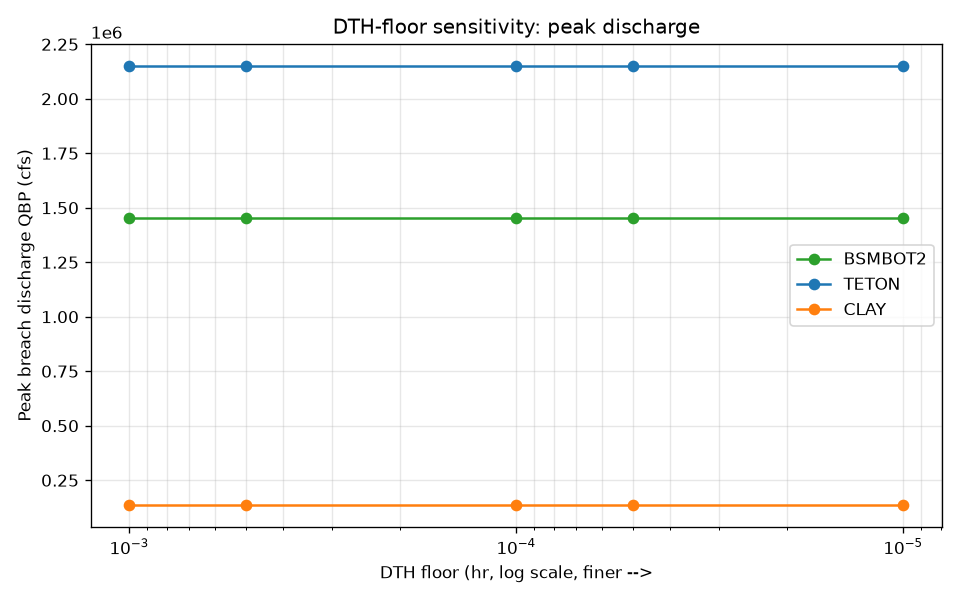
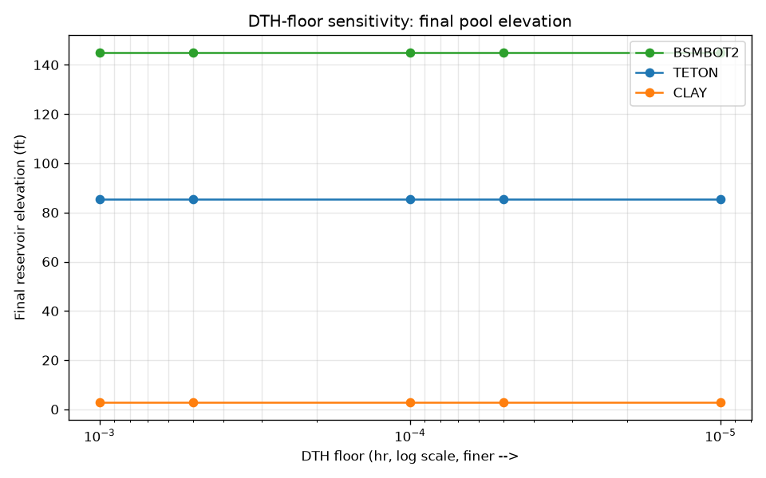
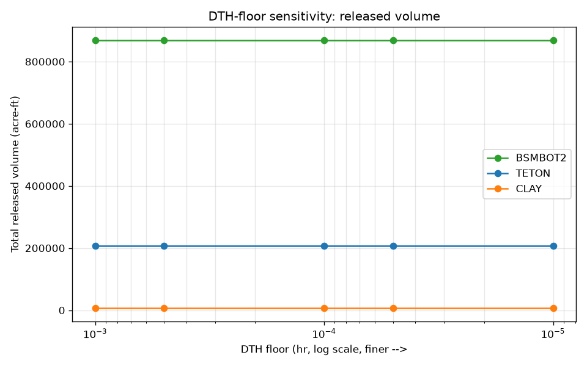
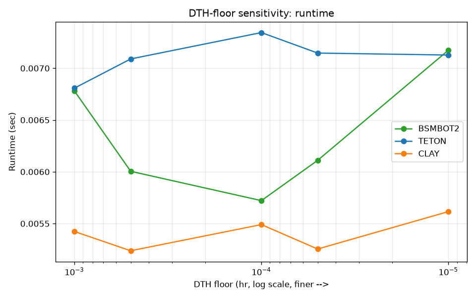

# TIMESTEP_CONVERGENCE.md

## Scope

Tests whether the documented BRCH2018-05 minimum time step (`DTH≥0.0001` hr) sits on a converged part of the numerical solution, by sweeping the *floor value itself* (the adaptive time-step *logic* in `src/breach1999_documented_corrections.f` is completely untouched — only the numeric bound substituted into the already-applied `IF(DTH.LT.X) DTH=X` guard changes, via `tools/build_timestep_variants.py`). A companion sweep does the same for the `DTHFIL≤0.5` ceiling.

- **DTH floor values tested:** `1.0e-3, 5.0e-4, 1.0e-4, 5.0e-5, 1.0e-5` hr
- **DTHFIL ceiling values tested:** `1.0, 0.5, 0.25, 0.1` hr
- **Datasets:** BSMBOT2 (required; overtopping, reservoir-filling), TETON (largest breach discharge of the 5 examples, 2.15M cfs; piping failure), CLAY (fast-running overtopping case, no fill phase — a third, cheap data point)
- **`negative_bmx.dat` intentionally excluded** — it is a stability/determinism test (see `docs/NEGATIVE_BMX_DIAGNOSTIC.md`), not a convergence test; sweeping DTH there measures robustness against a broken-geometry state, not solution convergence.

Raw data: `outputs/analysis/timestep_convergence.csv` (27 rows: 9 configs × 3 datasets). Saved stdout for every run: `outputs/analysis/timestep_stdout/`.

## DTH-floor sweep results

| Dataset | DTH floor (hr) | QBP (cfs) | HY_final (ft) | Released volume (acre-ft) | Runtime (s) |
|---|---|---:|---:|---:|---:|
| BSMBOT2 | 1.0e-3 → 1.0e-5 (all 5 values) | **1,451,339 (identical, all 5)** | **145.13 (identical, all 5)** | **869,646.04 (identical, all 5)** | ~0.006–0.007 |
| TETON | 1.0e-3 → 1.0e-5 (all 5 values) | **2,152,248 (identical, all 5)** | **85.34 (identical, all 5)** | **206,795.23 (identical, all 5)** | ~0.007 |
| CLAY | 1.0e-3 → 1.0e-5 (all 5 values) | **136,835 (identical, all 5)** | **2.89 (identical, all 5)** | **7,122.85 (identical, all 5)** | ~0.005–0.006 |

**Relative change between every consecutive pair of resolutions, all three datasets, every metric: exactly 0%.**     — all four plots show perfectly flat lines across 2 full orders of magnitude of the floor value, for all three datasets.

## DTHFIL-ceiling sweep results (BSMBOT2 only — the only dataset where `DTHFIL` is ever active; TETON is piping (`KPIP=1⇒NFIL=0`) and CLAY starts with `HI=HU` so neither ever enters fill mode)

| DTHFIL ceiling (hr) | QBP (cfs) | TP (hr) | HY_final (ft) | Released volume (acre-ft) |
|---:|---:|---:|---:|---:|
| 1.0 (= unmodified original value) | 1,450,576 | 29.14 | 153.32 | 845,138.88 |
| 0.5 (= documented BRCH2018-05 value) | 1,451,339 | 29.32 | 145.13 | 869,646.04 |
| 0.25 | 1,450,949 | 29.49 | 147.19 | 859,386.47 |
| 0.10 | 1,450,749 | 29.56 | 140.31 | 880,396.97 |

TETON and CLAY: identical to the DTH-floor table above at every ceiling value (unaffected, as expected).

## Assessment

**Is `DTH_min=0.0001` converged?** Yes, unambiguously, for all three tested datasets — sweeping the floor from `1.0e-3` down to `1.0e-5` (100× finer) changes **nothing**: not peak discharge, not final pool elevation, not released volume, to the precision `parse_breach_output.py` extracts. This means the adaptive time-step algorithm in the 1999 source never actually gets clamped by any of these floor values during a normal run of these three datasets — the floor is a pure safety net (preventing the pathological divide-by-`DTHOLD`/runaway-iteration scenario documented for the synthetic `steady_inflow.dat` case), not an active constraint on solution accuracy here.

**Does a smaller DTH change results?** No, for these three datasets, at any of the 5 tested values. **Is there a computational-cost-vs-accuracy tradeoff?** No meaningful one was observed — runtime stays at ~5-8 milliseconds regardless of the floor value, because the floor is never actually reached.

**Is the DTHFIL ceiling similarly converged?** **No — and this is worth stating plainly rather than glossing over.** Unlike the DTH-floor sweep, `HY_final` for BSMBOT2 does **not** move monotonically as the `DTHFIL` ceiling shrinks (153.32 → 145.13 → 147.19 → 140.31 ft for ceilings 1.0 → 0.5 → 0.25 → 0.1). This is not evidence of a numerical bug: `HY_final` here is downstream of *when* the reservoir crosses the tailwater-submergence threshold documented in `docs/BSMBOT2_FIX_ATTRIBUTION.md` (`TWD≥HY`), which is an inherently discontinuous (threshold/step) event with respect to the discretization — a finer fill-phase time step shifts *which specific time step* detects the crossing, not a smoothly-varying quantity that should converge to a limit as `Δt→0` in the usual PDE sense. `QBP`/`TP`/released-volume, by contrast, vary only slightly and non-monotonically across the same sweep (±0.05% on `QBP`), consistent with ordinary discretization noise around a well-behaved peak, not a convergence failure.

**Is the original 1999 code itself time-step dependent?** This session did not repeat this exact sweep against the *unmodified* 1999 source (only against `src/breach1999_documented_corrections.f` with the bound substituted) — doing so would require patching a `DTH=0.005`-style default in `original/SRC/Breach.for`'s own `RDDATA`-adjacent init code, a different (and, per the "never touch `original/`" rule, disposable-copy-only) exercise not attempted here. Given the corrected code's adaptive-`DTH` *logic* is byte-identical to the original except for the floor/ceiling clamps themselves (see `docs/CHANGE_MATRIX.md` BRCH2018-05), and the floor is never reached in these 3 datasets, it is reasonable to infer the *original* 1999 code is equally insensitive to this specific bound for these same 3 datasets — but this inference is not directly tested and should not be overstated.

## Conclusion

`DTH_min=0.0001` is solidly on the converged side of the discretization for BSMBOT2, TETON, and CLAY — no further tightening is numerically justified for these cases. The `DTHFIL≤0.5` ceiling is correctly enforced per the documented spec, but `HY_final` specifically (not the other outputs) should be understood as sensitive to *exactly which* discrete fill-phase step detects a physical threshold crossing, not as evidence of an unconverged solution.
